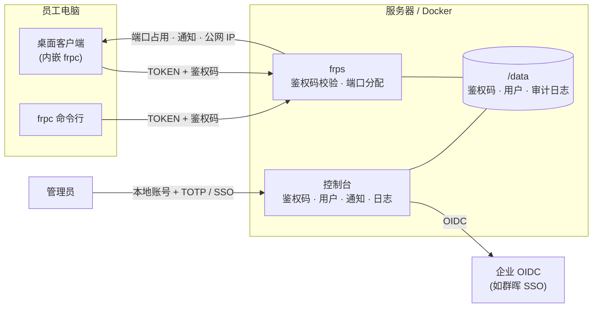

# frp Enterprise

[](https://github.com/czwstc/frp-enterprise/actions/workflows/enterprise-docker.yml)
[](https://github.com/czwstc/frp-enterprise/actions/workflows/golangci-lint.yml)

中文 | [English](README_en.md)

**frp Enterprise** 是基于 [frp](https://github.com/fatedier/frp) 深度定制的内网穿透方案，面向需要**私有化部署**的中小企业：

- **客户端**：员工使用桌面客户端登录，管理员能看到每台设备的登录状态，并决定谁能接入。
- **服务端**：控制台对接企业已有的单点登录（OIDC，例如群晖 SSO），所有操作都有审计记录。
- **部署**：用 Docker 一条命令部署。

它保留了 frp 的全部转发能力（TCP / UDP / HTTP / HTTPS / STCP / XTCP 等）。在此之上补齐了企业内网使用时缺少的部分：设备身份、审批、可见性和审计。

---

## 目录

- [功能特性](#功能特性)
- [架构](#架构)
- [快速开始](#快速开始)
- [Docker 部署指南](#docker-部署指南)
- [客户端](#客户端)
- [服务端控制台](#服务端控制台)
- [配置参考](#配置参考)
- [从源码构建](#从源码构建)
- [与上游 frp 的关系](#与上游-frp-的关系)

## 功能特性

### 客户端登录与审批

- **一机一码**：每台设备使用一个鉴权码登录，首次登录后就绑定到这台设备，别的设备拿同一个码会被拒绝。
- **两种发码方式**：
  - **管理员下发**：在控制台生成鉴权码，发给员工，填入后直接可用。
  - **员工申请**：客户端自己生成鉴权码并提交，管理员在控制台**批准**或**拒绝**；批准后客户端自动连上，不用手动重连。
- **随时吊销**：吊销或拒绝一个鉴权码，对应的客户端立即断开；也可以解除设备绑定，让员工换电脑。
- **登录状态可见**：客户端实时显示 `连接中 / 等待审批 / 运行中 / 已拒绝`；服务端控制台显示每个鉴权码绑定的主机、IP、最后在线时间和是否在线。

### 桌面客户端 HDIT-FRPE-Client（Windows / macOS / Linux）

- 用 [MyGo](https://mygo.egoist.dev) Native UI 编写：单个可执行文件，内嵌 frpc，不需要浏览器内核，也不用另装 frpc。
- 填写服务端地址、TOKEN 和鉴权码即可登录，鉴权码也可以一键生成后提交审批。
- 能看到的内容：
  - 运行状态、公网 IP 和本机 IP。本机有多个地址时默认显示第一个（IPv4 优先），其余在下拉框中查看。
  - 公网 IP 的来源可以在客户端“设置”页选择：服务端告知（frps 看到的连接来源地址，默认）、外部 API（默认 `https://api.ipify.org`，可改为其他返回纯文本 IP 或含 `ip` 字段 JSON 的地址）或不显示。
  - 本机的端口映射，可以增删改。
  - 服务端上已经转发的端口，以及哪些被其他客户端占用。
  - 服务端通知，新通知会弹窗提示。
  - 内嵌 frpc 的日志。
- **端口占用检查**：远端端口已被其他客户端占用，或者不在服务端允许的范围内时，填写时就会提示，并且不能保存。
- **统一外观**：Pulse 风格的侧栏和卡片界面，左上角只显示标志（默认是汇鼎标志）；图标、图标底衬和强调色跟随服务端“设置”页，修改后已连接的客户端立即同步。
- **加密锁定**：
  - 配置文件用本机绑定的密钥加密，复制到其他电脑上无法读取。
  - 开启锁定后，界面只显示运行状态和“重启”按钮，输入密码才能看到全部内容。
  - 锁定状态下开机仍会自动连接。

### 服务端控制台

- **鉴权码管理**：生成、批准、拒绝、吊销、解除设备绑定、备注；侧边栏显示待审批数量。
- **通知**：可以向全部客户端或指定的鉴权码发送通知；离线的客户端下次连接时会收到最近的通知。
- **端口总览**：能看到每个端口属于哪个鉴权码。
- **控制台账号**（开启后取代原有的 basic auth）：
  - **一个本地账号**：部署后第一次登录时绑定动态验证码（TOTP），同时生成 10 个一次性恢复密钥；之后每次登录都要密码加验证码，或者用一个恢复密钥代替。
  - **其他管理员用 OIDC 单点登录**，按用户名匹配。未登记的用户首次登录后需要**另一位管理员批准**；被停用或删除的用户会被立即登出。
  - 所有管理员权限相同，不区分角色。
- **审计日志**：记录谁、在什么时候、做了什么，包括登录、审批、鉴权码操作、通知、客户端上线和下线，支持检索。
- **运行日志**：直接在控制台查看 frps 最近的输出。
- **外观设置**：控制台采用 Pulse 风格（带彩色图标的侧栏、指标卡片、点阵曲线）。在“设置”页可以修改站点名称、左上角图标（默认汇鼎标志）及其底衬（黑色光晕、深色底板或无，让白色透明标志在浅色背景上看得清）、明暗主题、强调色，以及右上角的链接（自定义图片和地址、GitHub 图标或不显示），设置保存在服务端，对所有管理员、登录页和桌面客户端生效。

### 安全

- 连续输错 5 次后，该 IP 锁定 15 分钟；同一个动态验证码不能用两次；恢复密钥只能用一次。
- 会话 cookie 设置了 `HttpOnly`、`SameSite=Lax`；部署在 HTTPS 反向代理之后时，会根据 `X-Forwarded-Proto` 自动加上 `Secure`。所有修改操作都要带 CSRF 请求头。
- 配置里引用的环境变量没有设置时，frps 拒绝启动，避免空值或占位符被当成密码。

### 部署与交付

- 提供 Docker 镜像，以非 root 用户运行，数据都放在 `/data`；附带 `docker-compose.yml` 和中文部署文档。
- GitHub Actions 自动构建 `linux/amd64` 和 `linux/arm64` 镜像，推送到 GHCR（可选同时推送到 Docker Hub）。
- 桌面客户端可以打包为 macOS `.app` / `.dmg`、Windows `.exe` 和 Linux `.deb` / `tar.gz`。

## 架构



## 快速开始

### 1. 部署服务端

```bash
git clone https://github.com/czwstc/frp-enterprise.git
cd frp-enterprise/deploy/docker
cp .env.example .env   # 填写 TOKEN、本地账号密码、OIDC 信息
docker compose up -d
```

默认对外开放以下端口，都可以在 `docker-compose.yml` 和 `frps.toml` 中修改：

| 端口 | 用途 |
|---|---|
| `7000` | 客户端连接 |
| `7500` | 控制台 |
| `6000-6100` | 客户端可以映射的端口范围 |

详细说明见 [deploy/docker/README.md](deploy/docker/README.md)。

### 2. 首次登录控制台

1. 打开 `http://<服务器>:7500`，用 `.env` 中设置的本地账号和密码登录。
2. 用身份验证应用（Google Authenticator、Microsoft Authenticator、1Password 等）扫描二维码，输入 6 位验证码。
3. **保存页面上显示的 10 个恢复密钥**。它们只显示这一次，手机丢失时用来代替验证码登录。

### 3. 给员工发鉴权码

在控制台的 **鉴权码** 页点“生成鉴权码”，把生成的码发给员工。

员工也可以在客户端点“生成”，再把码发给你，你在 **鉴权码 → 待审批** 中批准即可。

### 4. 员工连接

- **桌面客户端**：打开后填写服务端地址、TOKEN 和鉴权码，点“连接”，然后在“端口映射”中添加需要暴露的本机服务。
- **命令行**：使用下面的 `frpc.toml`：

```toml
serverAddr = "frp.example.com"
serverPort = 7000
auth.token = "与服务端一致的 TOKEN"
clientID = "office-pc-01"          # 设备标识，鉴权码会绑定到它
loginFailExit = false              # 等待审批期间持续重试
enterprise.authCode = "XXXX-XXXX-XXXX-XXXX"

[[proxies]]
name = "rdp"
type = "tcp"
localIP = "127.0.0.1"
localPort = 3389
remotePort = 6001
```

## Docker 部署指南

### 准备

- 一台能被员工电脑访问到的 Linux 服务器（公网或公司内网均可），已安装 Docker 24 以上版本和 Docker Compose v2（`docker compose version` 能输出版本号）。
- 在服务器防火墙或云厂商安全组中放行端口：
  - `7000/tcp`：客户端连接。
  - 客户端映射的端口范围，默认 `6000-6100`，TCP 和 UDP 都要放行。
  - 控制台：经反向代理时放行 `443/tcp`，直接访问时放行 `7500/tcp`。
- 如果要用 SSO 登录控制台，先在 OIDC 服务端（例如群晖 SSO）登记一个应用，记下 client ID、client secret，回调地址填 `https://<控制台域名>/relay`（路径可以自定）。

### 1. 获取部署文件

有两种方式：直接用仓库里的 `deploy/docker` 目录（下面的命令），或者按 [1b](#1b-不克隆仓库自己创建部署目录) 自己创建 `docker-compose.yml`。

只需要仓库里的 `deploy/docker` 目录：

```bash
git clone --depth 1 https://github.com/czwstc/frp-enterprise.git
cd frp-enterprise/deploy/docker
cp .env.example .env
```

### 1b. 不克隆仓库，自己创建部署目录

也可以不下载仓库，直接在服务器上手写三个文件。下面以 `/opt/frps` 为例，配置和数据都放在宿主机目录里，方便查看和备份：

```text
/opt/frps/
├── docker-compose.yml   # 容器定义
├── .env                 # 密钥和账号（chmod 600）
├── config/
│   └── frps.toml        # frps 配置，只读挂载到 /etc/frp/frps.toml
└── data/                # 鉴权码、用户、审计日志、外观设置，挂载到 /data
```

**第 1 步：创建目录。** 镜像以非 root 用户运行，`data` 目录必须让容器里的用户可写。下面的 compose 用 `user: "1000:1000"` 指定运行用户，所以把目录交给 1000：

```bash
sudo mkdir -p /opt/frps/config /opt/frps/data
sudo chown -R 1000:1000 /opt/frps/data
cd /opt/frps
```

**第 2 步：`docker-compose.yml`。**

```yaml
services:
  frps:
    image: ghcr.io/czwstc/frps-enterprise:1.0.0   # 固定版本；也可用 :latest 或 :edge
    container_name: frps
    restart: unless-stopped
    user: "1000:1000"            # 与 data 目录的属主一致
    env_file: .env               # frps.toml 中 {{ .Envs.X }} 的值来自这里
    environment:
      TZ: Asia/Shanghai          # 日志和审计时间使用的时区
    ports:
      - "7000:7000"              # 客户端连接（bindPort）
      - "7500:7500"              # 控制台；用反向代理时改为 "127.0.0.1:7500:7500"
      - "6000-6100:6000-6100"    # 客户端可映射的端口，与 allowPorts 一致
      - "6000-6100:6000-6100/udp"
    volumes:
      - ./config/frps.toml:/etc/frp/frps.toml:ro   # 配置文件（只读）
      - ./data:/data                               # 数据目录（必须可写）
      # OIDC 使用自签名证书时，再挂载 CA，并在 frps.toml 中设置 trustedCaFile：
      # - ./config/ca.pem:/etc/frp/ca.pem:ro
```

挂载说明：

| 容器路径 | 宿主机路径 | 权限 | 用途 |
|---|---|---|---|
| `/etc/frp/frps.toml` | `./config/frps.toml` | 只读 | frps 配置；不挂载时使用镜像内置的默认配置 |
| `/data` | `./data` | 读写 | 所有持久数据，见[数据文件](#数据文件)；不挂载时数据会随容器删除 |

如果更喜欢 Docker 命名卷（不关心数据放在哪个目录），把 `./data:/data` 换成 `frps-data:/data`，在文件末尾加上 `volumes: { frps-data: {} }`，并去掉 `user` 一行即可，不需要 `chown`。

**第 3 步：`config/frps.toml`。** 内容与仓库里的 [deploy/docker/frps.toml](deploy/docker/frps.toml) 相同，可以直接下载：

```bash
curl -fsSL -o config/frps.toml \
  https://raw.githubusercontent.com/czwstc/frp-enterprise/v1.0.0/deploy/docker/frps.toml
```

关键配置如下，数据文件路径都要指向 `/data`：

```toml
bindPort = 7000
auth.token = "{{ .Envs.FRPS_TOKEN }}"
allowPorts = [{ start = 6000, end = 6100 }]   # 与 compose 的 ports 保持一致

webServer.addr = "0.0.0.0"
webServer.port = 7500

enterprise.enabled = true
enterprise.storePath = "/data/frps_enterprise.json"
enterprise.brandingPath = "/data/frps_branding.json"

enterprise.admin.enabled = true
enterprise.admin.storePath = "/data/frps_admin.json"
enterprise.admin.auditLogPath = "/data/frps_audit.log"
enterprise.admin.localUser.username = "{{ .Envs.FRPS_ADMIN_USER }}"
enterprise.admin.localUser.password = "{{ .Envs.FRPS_ADMIN_PASSWORD }}"

# 不用 SSO 时删除下面整段
enterprise.admin.oidc.issuer = "{{ .Envs.FRPS_OIDC_ISSUER }}"
enterprise.admin.oidc.clientID = "{{ .Envs.FRPS_OIDC_CLIENT_ID }}"
enterprise.admin.oidc.clientSecret = "{{ .Envs.FRPS_OIDC_CLIENT_SECRET }}"
enterprise.admin.oidc.redirectURL = "{{ .Envs.FRPS_OIDC_REDIRECT_URL }}"
enterprise.admin.oidc.scopes = ["openid", "email", "groups"]
enterprise.admin.oidc.displayName = "{{ .Envs.FRPS_OIDC_NAME }}"
```

`{{ .Envs.X }}` 会在启动时替换成 `.env` 里的值，这样密钥不必写进配置文件。也可以直接写明文，但那样 `frps.toml` 也要按密钥对待。

**第 4 步：`.env`。**

```bash
cat > .env <<'ENV'
FRPS_TOKEN=请替换为随机字符串
FRPS_ADMIN_USER=admin
FRPS_ADMIN_PASSWORD=请替换为至少8位的密码
FRPS_OIDC_ISSUER=https://nas.example.com:5001/webman/sso
FRPS_OIDC_CLIENT_ID=
FRPS_OIDC_CLIENT_SECRET=
FRPS_OIDC_REDIRECT_URL=https://frp.example.com/relay
FRPS_OIDC_NAME=群晖 SSO
ENV
chmod 600 .env
```

各变量的含义见下一节。准备好后，从[第 3 步](#3-拉取镜像)继续。使用宿主机目录时，备份只需要复制 `/opt/frps` 整个目录（先 `docker compose stop`）。

### 2. 填写 `.env`

| 变量 | 说明 |
|---|---|
| `FRPS_IMAGE` | 镜像，默认 `ghcr.io/czwstc/frps-enterprise:edge`（`dev` 分支的最新构建）；推送 `vX.Y.Z` 标签后也可以用 `:latest` 或固定版本 `:X.Y.Z` |
| `FRPS_TOKEN` | 客户端连接用的 TOKEN，建议用 `openssl rand -hex 24` 生成 |
| `FRPS_ADMIN_USER` / `FRPS_ADMIN_PASSWORD` | 控制台本地账号，密码至少 8 位 |
| `FRPS_OIDC_ISSUER` | OIDC 地址，例如 `https://nas.example.com:5001/webman/sso`；不用 SSO 时留空 |
| `FRPS_OIDC_CLIENT_ID` / `FRPS_OIDC_CLIENT_SECRET` | OIDC 应用的 ID 和密钥 |
| `FRPS_OIDC_REDIRECT_URL` | 回调地址，必须和 OIDC 服务端登记的完全一致 |
| `FRPS_OIDC_NAME` | 登录页 SSO 按钮上显示的名称 |

`.env` 中有密钥，请设置 `chmod 600 .env`，并且不要提交到 Git。任何一个被引用的变量没有设置时，frps 会拒绝启动并说明缺少哪一项。

### 3. 拉取镜像

镜像由 GitHub Actions 推送到 GHCR。GHCR 的包默认是私有的，二选一：

- 在仓库的 Packages 设置中把 `frps-enterprise` 改为公开。
- 或者在服务器上登录 GHCR：先创建一个只有 `read:packages` 权限的 Personal Access Token，再执行：

  ```bash
  echo <token> | docker login ghcr.io -u <GitHub 用户名> --password-stdin
  ```

### 4. 启动并检查

```bash
docker compose up -d
docker compose ps                         # 状态应为 running
docker compose logs -f frps               # 查看启动日志
curl -s -o /dev/null -w "%{http_code}\n" http://127.0.0.1:7500/healthz   # 返回 200
```

然后打开控制台，按[首次登录控制台](#2-首次登录控制台)设置动态验证码，并保存恢复密钥。

### 5. 用 HTTPS 访问控制台（推荐）

生产环境建议只让反向代理访问控制台。先把 `docker-compose.yml` 中的 `"7500:7500"` 改为 `"127.0.0.1:7500:7500"`，再配置反向代理。frps 会根据 `X-Forwarded-Proto` 给登录 cookie 加上 `Secure`。

Caddy（自动申请证书）：

```text
frp.example.com {
    reverse_proxy 127.0.0.1:7500
}
```

Nginx：

```nginx
server {
    listen 443 ssl;
    server_name frp.example.com;
    ssl_certificate     /etc/ssl/frp.example.com.crt;
    ssl_certificate_key /etc/ssl/frp.example.com.key;

    location / {
        proxy_pass http://127.0.0.1:7500;
        proxy_set_header Host $host;
        proxy_set_header X-Forwarded-For $proxy_add_x_forwarded_for;
        proxy_set_header X-Forwarded-Proto $scheme;
    }
}
```

改用 HTTPS 后，同步修改 `.env` 中的 `FRPS_OIDC_REDIRECT_URL` 和 OIDC 服务端登记的回调地址，再执行 `docker compose up -d`。

### 6. 修改配置或端口范围

镜像内置的配置是 [deploy/docker/frps.toml](deploy/docker/frps.toml)。要修改时：

1. 把它复制到 `docker-compose.yml` 旁边并修改，例如把 `allowPorts` 改为 `[{ start = 20000, end = 20100 }]`。
2. 在 `docker-compose.yml` 中取消注释这一行：`- ./frps.toml:/etc/frp/frps.toml:ro`。
3. 把 `ports` 里的映射范围改成同样的范围（TCP 和 UDP 各一行）。
4. 执行 `docker compose up -d`。

### 7. 升级

```bash
docker compose pull
docker compose up -d
```

数据都在 `frps-data` 卷（或 1b 中的 `./data` 目录）中，升级不会丢失。会话保存在内存里，升级后管理员需要重新登录，客户端会自动重连。

### 8. 备份与迁移

所有数据都在容器的 `/data` 目录：

- `frps_enterprise.json`：鉴权码和通知。
- `frps_admin.json`：用户、本地账号的二次验证信息。
- `frps_audit.log`：审计日志。
- `frps_branding.json`：外观设置。

```bash
docker compose cp frps:/data ./frps-backup-$(date +%F)    # 备份
docker compose cp ./frps-backup-2026-11-07/. frps:/data   # 在新服务器上恢复，然后重启
docker compose restart frps
```

迁移到新服务器时，连同 `.env` 一起复制；客户端只要改连接地址（或保持域名不变）即可，鉴权码和设备绑定都保留。

### 9. 自行构建镜像

```bash
docker build -f dockerfiles/Dockerfile-enterprise-frps -t frps-enterprise:local .
```

然后把 `.env` 中的 `FRPS_IMAGE` 改为 `frps-enterprise:local`。

### 常见问题

| 现象 | 处理 |
|---|---|
| 启动后立即退出，日志提示 `comes from an environment variable that is not set` | `.env` 中缺少对应变量，补上后重新启动 |
| 拉取镜像提示 `denied` 或 `unauthorized` | GHCR 包是私有的，见[第 3 步](#3-拉取镜像) |
| SSO 登录后提示回调地址不匹配 | `FRPS_OIDC_REDIRECT_URL` 与 OIDC 服务端登记的地址不一致，注意 http 和 https、端口、路径都要相同 |
| 动态验证码总是错误 | 检查服务器和手机的时间，误差需要在 30 秒以内（服务器可启用 NTP） |
| 客户端已运行，但映射的端口从外部访问不到 | 检查云安全组或防火墙是否放行该端口，以及端口是否在 `allowPorts` 和 compose 的 `ports` 范围内 |
| 本地账号的手机丢了，恢复密钥也用完了 | 让通过 SSO 登录的管理员在“用户”页重置二次验证；没有 SSO 管理员时，停止容器，删除 `/data/frps_admin.json` 中 `local` 部分后重启（SSO 用户也会一并清除，请先备份） |

## 客户端

### 下载

在 [Releases](https://github.com/czwstc/frp-enterprise/releases) 下载 HDIT-FRPE-Client：

| 系统 | 文件 |
|---|---|
| macOS（Apple 芯片和 Intel） | `hdit-frpe-client-<版本>-universal.dmg` |
| Windows x64 | `HDIT-FRPE-Client-<版本>-windows-amd64.zip`（解压后直接运行 `HDIT-FRPE-Client.exe`，无需安装其他组件） |
| Linux x64 / ARM64 | `.deb` 安装包，或 `.tar.gz`（解压后运行 `install.sh`） |

安装包目前没有代码签名：macOS 首次打开时请右键选择“打开”，Windows 可能出现 SmartScreen 提示，选择“仍要运行”即可。

### 登录状态

| 状态 | 含义 | 客户端行为 |
|---|---|---|
| 连接中 | 正在连接服务端，或 TOKEN、网络有问题 | 自动重试 |
| 等待审批 | 鉴权码已提交，管理员还没批准 | 自动重试，批准后自动连上 |
| 运行中 | 已登录，端口映射生效 | 断线后自动重连 |
| 已拒绝 | 鉴权码被拒绝或吊销，或已绑定其他设备 | 停止重试 |
| 错误 | 其他错误 | 显示错误信息 |

### 桌面客户端

源码在 [desktop/frpc-gui](desktop/frpc-gui)，使用说明见 [desktop/frpc-gui/README.md](desktop/frpc-gui/README.md)。

- **配置文件位置**：保存在系统用户配置目录下的 `frpc-enterprise/config.enc`。设置环境变量 `FRPC_GUI_CONFIG` 可以改到其他路径。
- **自动连接**：登录成功后，下次打开会自动连接；点“退出登录”后不再自动连接。

## 服务端控制台

| 页面 | 内容 |
|---|---|
| 概览 | 客户端、端口映射、流量、连接、端口占用、鉴权码的指标卡片和点阵曲线，以及待处理的申请和最近审计 |
| 客户端 / 代理 | frp 原有的客户端和代理页面 |
| 鉴权码 | 生成、审批、吊销、解除绑定、备注；显示在线状态、主机、IP 和最后在线时间 |
| 通知 | 发送通知，查看历史通知和服务端端口占用 |
| 用户 | 本地账号的二次验证状态（可重新生成恢复密钥、重置二次验证），以及 SSO 用户的登记、批准、拒绝、停用和删除 |
| 日志 | 审计日志（可按类别筛选、搜索），运行日志（可按级别筛选、自动刷新） |
| 服务端信息 | frp 原有的服务端配置和统计 |
| 设置 | 站点名称、左上角图标、明暗主题、强调色、右上角链接，修改时实时预览 |

## 配置参考

服务端 `frps.toml` 中与企业版相关的配置：

```toml
webServer.addr = "0.0.0.0"
webServer.port = 7500

# 客户端必须使用鉴权码登录
enterprise.enabled = true
enterprise.storePath = "/data/frps_enterprise.json"
# 外观设置（在控制台“设置”页修改）
enterprise.brandingPath = "/data/frps_branding.json"

# 控制台账号（开启后 webServer.user/password 不再生效）
enterprise.admin.enabled = true
enterprise.admin.storePath = "/data/frps_admin.json"
enterprise.admin.auditLogPath = "/data/frps_audit.log"
enterprise.admin.sessionTTLHours = 12
enterprise.admin.localUser.username = "admin"
enterprise.admin.localUser.password = "{{ .Envs.FRPS_ADMIN_PASSWORD }}"
# 也可以用 bcrypt 哈希代替明文密码：
# enterprise.admin.localUser.passwordHash = "$2a$10$..."

# OIDC 单点登录（不需要时删除 issuer 一行即可）
enterprise.admin.oidc.issuer = "https://nas.example.com:5001/webman/sso"
enterprise.admin.oidc.clientID = "..."
enterprise.admin.oidc.clientSecret = "{{ .Envs.FRPS_OIDC_CLIENT_SECRET }}"
# 回调地址：frps 在这个地址的路径上处理回调，路径可以任意设置
enterprise.admin.oidc.redirectURL = "https://frp.example.com/relay"
enterprise.admin.oidc.scopes = ["openid", "email"]
# 用户名取自哪个 claim；默认依次取 preferred_username、username、email
# enterprise.admin.oidc.usernameClaim = "username"
enterprise.admin.oidc.displayName = "群晖 SSO"
# OIDC 服务端使用自签名证书时：
# enterprise.admin.oidc.trustedCaFile = "/data/ca.pem"
```

完整的配置项见 [conf/frps_full_example.toml](conf/frps_full_example.toml) 和 [conf/frpc_full_example.toml](conf/frpc_full_example.toml)。frp 原有的配置项全部保留，说明见[上游文档](doc/upstream/README_zh.md)。

### 数据文件

| 文件 | 内容 |
|---|---|
| `frps_enterprise.json` | 鉴权码、设备绑定、通知 |
| `frps_admin.json` | SSO 用户，以及本地账号的 TOTP 密钥和恢复密钥（只保存哈希） |
| `frps_audit.log` | 审计日志，每行一条 JSON |
| `frps_branding.json` | 外观设置：名称、图标、主题、强调色、右上角链接 |

## 从源码构建

需要 Go 1.26 或更高版本、Node.js 22。桌面客户端另外需要 Go 1.27.3 或更高版本。

```bash
make web          # 构建 frps / frpc 控制台前端
make build        # 构建 bin/frps 和 bin/frpc
make test         # 单元测试
make e2e          # 端到端测试（需要 ginkgo）

make gui          # 打包当前平台的桌面客户端
make gui-cross    # 打包 macOS / Windows / Linux 的桌面客户端
make gui-test     # 桌面客户端视图测试
```

Docker 镜像：

```bash
docker build -f dockerfiles/Dockerfile-enterprise-frps -t frps-enterprise .
```

推送到 `dev` 或 `main` 分支、或者推送 `vX.Y.Z` 标签时，[GitHub Actions](.github/workflows/enterprise-docker.yml) 会构建镜像并推送到 `ghcr.io/czwstc/frps-enterprise` 和 `ghcr.io/czwstc/frpc-enterprise`。

## 与上游 frp 的关系

- **上游项目**：基于 [fatedier/frp](https://github.com/fatedier/frp)，会定期合并上游更新。
- **兼容性**：
  - 没开启 `enterprise.enabled` 时，frps 的行为和上游一致。
  - 企业版 frps 只会向声明支持新消息的客户端发送新增的协议消息，旧版 frpc 连接时不会断开。但开启鉴权码登录后，所有客户端都必须带鉴权码。
- **frp 原版文档**：[中文](doc/upstream/README_zh.md) · [English](doc/upstream/README.md)。
- **许可证**：沿用 [Apache License 2.0](LICENSE)。
